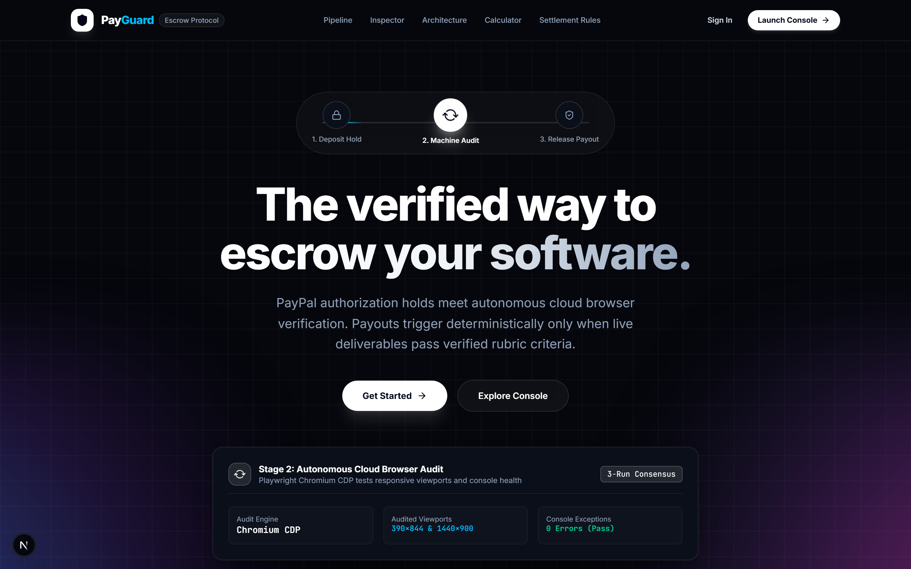
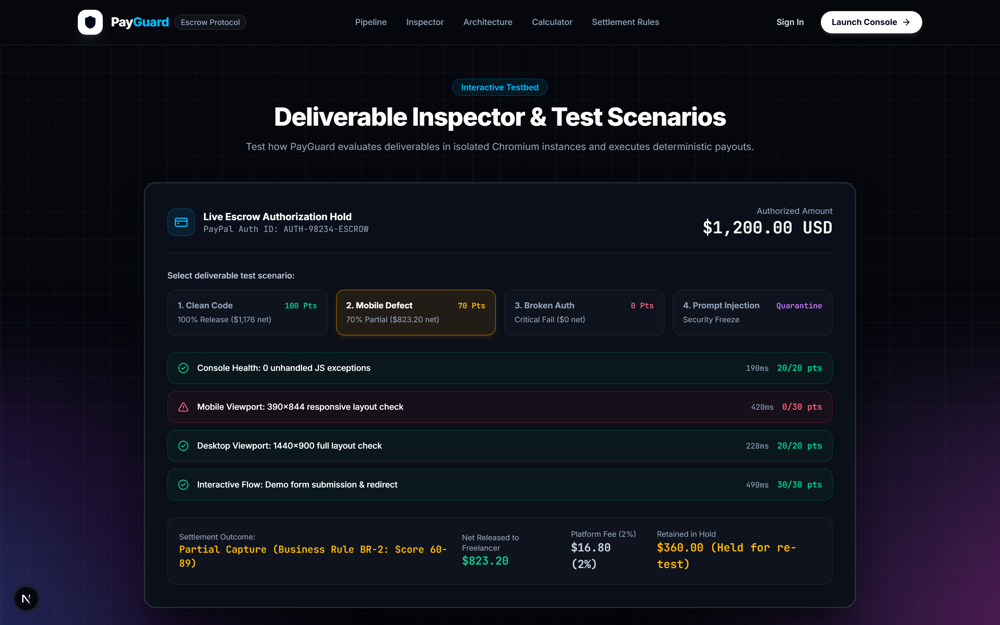
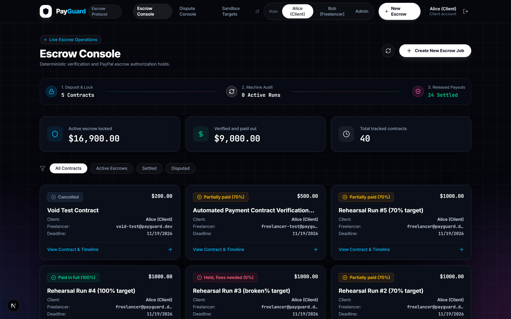
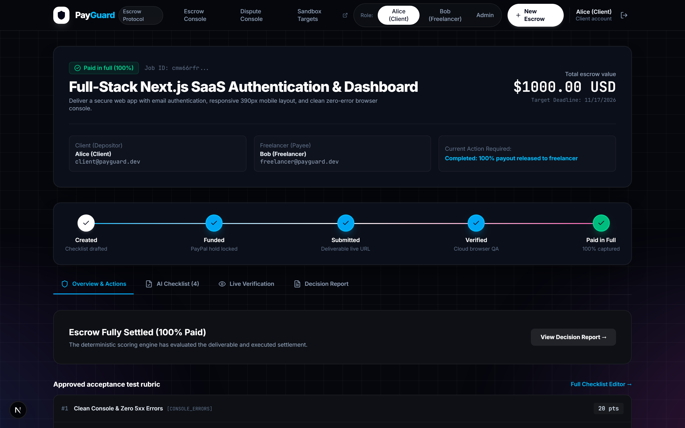
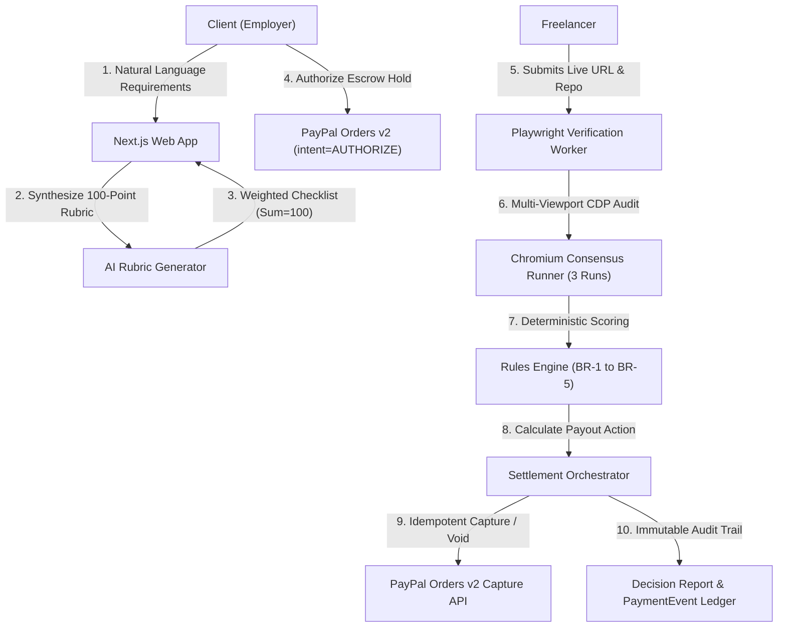

# PayGuard Escrow — Autonomous AI Payment Verification & Escrow Platform

> **Autonomous AI Escrow for Verified Software Deliverables**  
> *"AI Proposes, Code Disposes"*  
> Full-Stack Hackathon Implementation | PayPal Developer Challenge 2026

PayGuard Escrow bridges **PayPal authorization holds (`intent=AUTHORIZE`)** with **autonomous cloud browser verification**. Client funds are locked securely without moving upfront, deliverables are independently audited against a 100-point rubric using headless Chromium, and payments are captured or released deterministically based on verified code execution.

---

## 📸 Visual Showcase & Obsidian UI

| Hero & 3-Stage Pipeline | Interactive Deliverable Inspector |
| :---: | :---: |
|  |  |

| Escrow Console & Telemetry | Deterministic Decision Report & Milestones |
| :---: | :---: |
|  |  |

---

## 🎯 Core Objective & Problem Statement

### The Problem
Traditional software escrow platforms suffer from human subjectivity, slow dispute resolution (averaging 2–3 weeks), and financial vulnerability:
- **Clients** fear paying upfront for broken deliverables or phantom code.
- **Freelancers** fear being stiffed, ghosted, or trapped in endless unpaid revisions.

### The Solution: PayGuard Escrow
PayGuard turns **software code into its own financial arbitrator**:
1. **Trustless Escrow (Zero Upfront Risk)**: Funds are locked via PayPal pre-authorization (`intent=AUTHORIZE`). If code fails minimum criteria, holds are voided with 100% money-back guarantee.
2. **Deterministic Verification (Freelancer Protection)**: Both parties agree to an immutable 100-point rubric. Playwright Chromium audits live deliverables. When tests pass, payment captures **instantly** without requiring manual client signatures.
3. **Proportional Fairness (No All-or-Nothing Traps)**: Minor responsive defects release a 70% partial payment with 1 free automated re-test to fix issues.

---

## 🏛️ System Architecture & Lifecycle



---

## ⚖️ Deterministic Business Rules Engine (BR-1 to BR-5)

| Rule | Score Criteria | Settlement Action | Freelancer Payout | Client Protection | State Tier |
| :---: | :---: | :--- | :---: | :---: | :---: |
| **BR-1** | **≥ 90 / 100** | **100% Full Capture** via PayPal Orders v2 | **98.0% Net** (2% fee) | Code fully validated | `PAID` |
| **BR-2** | **60 – 89 / 100** | **70% Partial Capture**, 30% Retained in Hold | **68.6% Net** Disbursed | 30% held for 1 free re-test | `PARTIALLY_PAID` |
| **BR-3** | **< 60 / 100** | **0% Capture**, 100% Retained in Escrow | **$0.00** | 100% Escrow Protection | `HELD` |
| **BR-4** | Expired | **100% Void / Refund** via Watcher Cron | **$0.00** | 100% Voided & Unlocked | `VOIDED` |
| **BR-5** | Critical Fail | **Hard Override to 0 Score** | **$0.00** | Critical safety override | `HELD` |

- **Strict Idempotency**: Every capture enforces a deterministic idempotency key (`job:{id}:run:{id}:capture`) preventing double-capture under network retries.
- **SSRF Blocklist**: Blocks loopback (`127.0.0.1`), private IPv4/IPv6 CIDR ranges, and non-HTTPS submission URLs.
- **AES-256-GCM**: Credentials and environment variables encrypted with unique initialization vectors (IVs).

---

## 🌐 21 Connected API Endpoints

```
├── Authentication & Profiles
│   ├── POST /api/auth/demo              # 1-Click Role Switcher (Client, Freelancer, Admin)
│   ├── GET  /api/auth/me                # Current session identity & PayPal email
│   ├── POST /api/auth/login             # Secure bcrypt authentication
│   ├── POST /api/auth/logout            # Session cookie revocation
│   └── POST /api/auth/register          # Account onboarding
├── Escrow Contracts & Governance
│   ├── GET  /api/jobs                   # Filtered contract ledger
│   ├── POST /api/jobs                   # Create contract & compile natural-language rubric
│   ├── GET  /api/jobs/[id]              # Contract details, milestone stepper & payments
│   ├── GET  /api/jobs/[id]/events       # Real-time SSE stream for live verification
│   ├── PUT  /api/jobs/[id]/checklist    # Update rubric weights (enforces sum=100 constraint)
│   ├── POST /api/jobs/[id]/checklist/approve  # Dual-party rubric sign-off
│   └── POST /api/jobs/[id]/checklist/generate # AI-assisted rubric regeneration
├── PayPal Orders v2 & Settlement
│   ├── POST /api/jobs/[id]/fund/create-order  # PayPal order creation (intent=AUTHORIZE)
│   ├── POST /api/jobs/[id]/fund/authorize     # Authorize escrow hold
│   └── POST /api/webhooks/paypal              # Webhook listener with HMAC verification
├── Deliverable Audit & Decision Reports
│   ├── POST /api/jobs/[id]/submit       # Enqueue deliverable for 3-run consensus audit
│   ├── POST /api/jobs/[id]/retest       # Request 1 free re-test for partially paid contracts
│   └── GET  /api/jobs/[id]/runs/[runId] # Decision Report, KaTeX score ring & logs
└── Admin Arbitration & Watcher
    ├── GET  /api/cron/watcher           # Deadline expiration daemon (auto-voiding holds)
    ├── POST /api/jobs/[id]/dispute      # Open formal escrow dispute
    ├── POST /api/admin/disputes/[id]/resolve  # Arbitrate & disburse funds or refund
    └── GET  /api/admin/events           # Append-only immutable audit trail stream
```

---

## 🚀 Getting Started

### 1. Prerequisites
- **Node.js**: v18+ or v20+
- **Google Chrome** or **Chromium** installed locally

### 2. Install Dependencies & Seed Database
```bash
# Install packages
npm install

# Push database schema & seed demo contracts
npx prisma db push
npm run seed
```

### 3. Run Automated Tests
```bash
# Run unit & integration test suites (36 tests, 100% passing)
npm run test:node

# Run Vitest suite
npm run test
```

### 4. Start Development Server
```bash
npm run dev
```
Open **[http://localhost:3000](http://localhost:3000)** in your browser.

---

## 🖥️ Live Browser Automation & Demo Scripts

PayGuard includes automated visual runners that demonstrate the application directly in Google Chrome:

```bash
# 1. Run full automated visual test with glowing cursor and live clicks
node scripts/visual-cursor-demo.mjs

# 2. Audit all 21 API endpoints with live authentication
node scripts/test-all-endpoints.mjs

# 3. High-resolution screenshot capture exporter
node scripts/capture-all-views.mjs
```

---

## 🎭 Pre-Configured Demo Accounts (1-Click Switcher in Navbar)

| Role | Name | Email | Password | Permissions |
| :--- | :--- | :--- | :--- | :--- |
| **Client** | Alice | `client@payguard.dev` | `password123` | Create escrow jobs, approve rubrics, authorize PayPal holds |
| **Freelancer** | Bob | `freelancer@payguard.dev` | `password123` | Accept jobs, submit live deliverable URLs, request re-tests |
| **Admin** | Arbiter | `admin@payguard.dev` | `password123` | Dispute arbitration, override payouts, inspect immutable ledger |

---

## 🛠️ Tech Stack

- **Framework**: [Next.js 16](https://nextjs.org/) (Turbopack, App Router, React 19)
- **Styling**: Tailwind CSS v4, Obsidian Blueprint Grid Mesh, Lucide Icons
- **Database & ORM**: [Prisma](https://www.prisma.io/) with SQLite
- **Payments**: PayPal Orders v2 API (`intent=AUTHORIZE`, Proportional Captures, Webhooks)
- **Browser Automation**: [Playwright](https://playwright.dev/) Chromium CDP multi-viewport runner
- **Security**: AES-256-GCM, SSRF blocklist, timing-safe HMAC authentication tokens

---

## 📄 License
MIT © 2026 PayGuard Escrow Contributors. Built for the PayPal Developer Hackathon.
