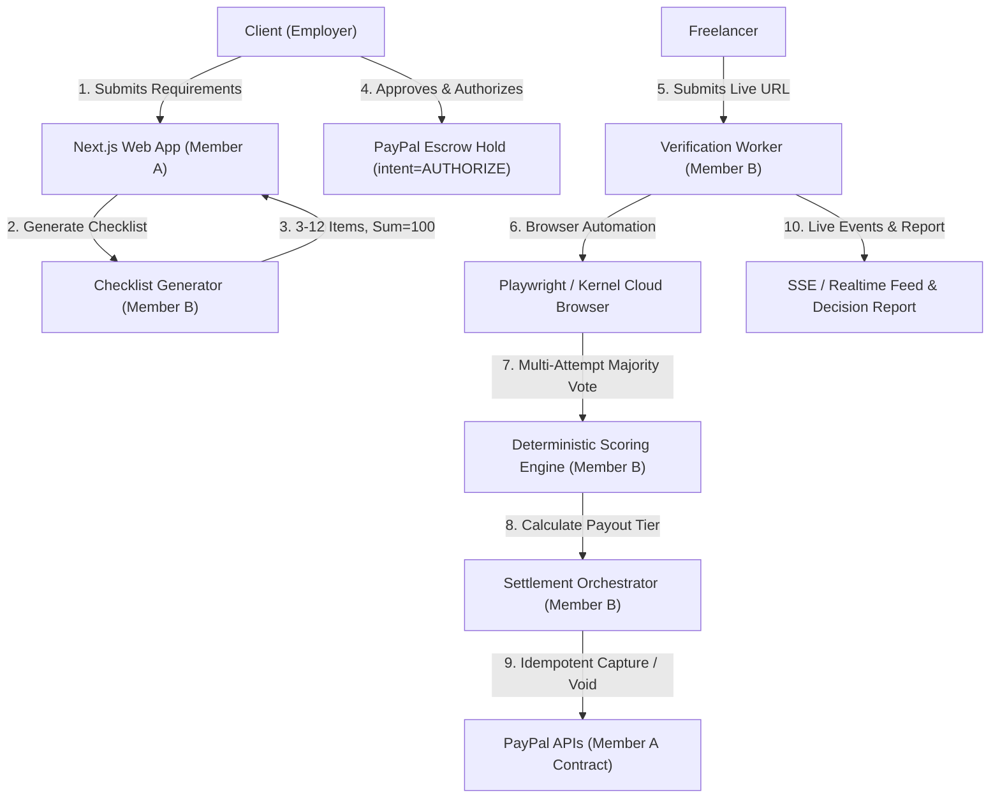

# PayGuard Escrow — Autonomous AI Payment Verification & Escrow Platform

> **Autonomous AI Escrow for Verified Software Deliverables**  
> *"AI Proposes, Code Disposes"*  
> Complete 2-Member Hackathon Implementation (Member A: Platform, Payments & UI | Member B: AI Agent, Browser Automation & Deterministic Scoring)

PayGuard Escrow holds client funds in a PayPal authorization hold (`intent=AUTHORIZE`), deploys an AI cloud browser agent to independently test live web deliverables against an agreed checklist, and deterministically captures funds (100% full capture, 70% partial capture, or 0% hold) based on verifiable results.

---

## 👥 Team Work Split & Roles

| Dimension | Member A: Platform, Payments & Frontend | Member B: AI Agent & Verification Engine |
| :--- | :--- | :--- |
| **Core Focus** | Next.js 16 Web App, Prisma DB, PayPal Sandbox, Live UI | Cloud browser agent, test runner, deterministic scoring, settlement orchestrator |
| **Code Ownership** | `/app`, `/components`, `/lib/paypal` | `/worker`, `/lib/agent`, `/lib/scoring`, `/demo-sites` |
| **Mindset** | *"Money is correct and the UI is smooth"* | *"Results are consistent and explainable"* |

---

## 🏛️ System Architecture



---

## 📦 Directory Structure

```
├── app/                      # Next.js 16 App Router (Member A)
│   ├── api/                  # REST & SSE Endpoints (jobs, fund, checklist, submit, events)
│   ├── demo/                 # Built-in demo target routes (/demo/good, /demo/mobile-broken, etc.)
│   ├── jobs/                 # Job creation, overview, and verification pages
│   └── page.tsx              # Landing page
├── components/               # UI Components (MilestoneStepper, DecisionReport, LiveVerificationView)
├── lib/
│   ├── agent/                # Browser automation, test runner, security & report writer (Member B)
│   ├── scoring/              # Deterministic scoring engine & settlement orchestrator (Member B)
│   ├── paypal/               # PayPal sandbox client & idempotent capture ledger (Member A)
│   ├── db.ts                 # Prisma SQLite / PostgreSQL client
│   ├── security.ts           # SSRF validator & AES-256-GCM encryption
│   └── state-machine.ts      # Strict job state transition machine
├── worker/                   # Background verification queue runner (Member B)
├── demo-sites/               # Standalone test fixtures & demo HTTP server (Member B)
├── prisma/                   # 12 Core Entities Schema & Seed data
├── types/                    # Shared TypeScript interfaces (RunResult, RunEvent, ChecklistItem, etc.)
├── test/                     # Vitest test suite for Member B (scoring, agent security, e2e browser runs)
├── tests/                    # Node test suite for Member A (paypal, state machine, security)
└── README.md
```

---

## ⚖️ Business Rules & Scoring Engine (BR-1 to BR-6)

- **BR-1 (Score ≥ 90):** 100% full capture (`final_capture = true`). State → `PAID` (Green).
- **BR-2 (Score 60–89):** 70% partial capture (`final_capture = false`). State → `PARTIALLY_PAID` (Yellow). Remaining 30% held for re-test.
- **BR-3 (Score < 60):** 0% capture. State → `HELD` (Red). Freelancer can fix issues and submit re-test.
- **BR-5 (Hard-Fail Critical Check):** If any item marked `critical: true` fails, score is overridden to 0, state moves to `HELD`.
- **BR-6 (Platform Fee):** 2% fee deducted from payouts, displayed upfront before client funding.
- **FR-23 (Inconclusive Threshold):** If >30% of tests are inconclusive, state moves to `NEEDS_REVIEW`.
- **FR-26 (Idempotency):** Every capture enforces unique key `job:{id}:run:{id}:capture` to prevent double-capture under any retry.

---

## 🚀 Quickstart

### 1. Install Dependencies & Initialize Database
```bash
npm install
npx prisma db push
npm run seed
```

### 2. Run Comprehensive Test Suites
```bash
# Member B Vitest suite (Scoring engine, Agent security, and Playwright E2E)
npx vitest run

# Member A Node test suite (State machine, PayPal idempotency, Security)
npm run test:node
```

### 3. Start Web App & Verification Worker
```bash
# Start Next.js App
npm run dev

# (Optional) Start standalone demo target sites
npm run demo:serve
```
Open [http://localhost:3000](http://localhost:3000) in your browser.

---

## 🎭 Pre-Configured Demo Accounts (1-Click Switcher)
- **Alice (Client):** `client@payguard.dev` / `password123`
- **Bob (Freelancer):** `freelancer@payguard.dev` / `password123`
- **Admin:** `admin@payguard.dev` / `password123`
